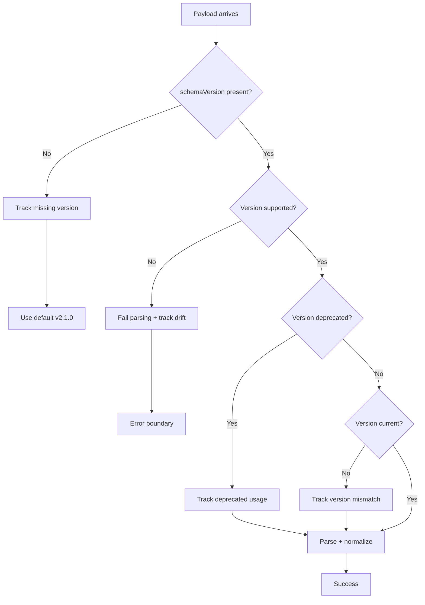

# Contract Compatibility Matrix

**Last Updated**: 2026-05-19  
**Current Version**: `2.1.0`

This document defines the contract versioning policy for MARCOM/Lumi API contracts. It serves as the "treaty table" between frontend clients, backend services, mobile apps, workers, and any future integrations.

---

## Version Support Matrix

| Backend Version | Supports Client Versions | Status | Notes |
|----------------|-------------------------|--------|-------|
| `2.1.x` | `2.0.x` → `2.1.x` | ✅ **Current** | Added schemaVersion field (Phase 9) |
| `2.0.x` | `2.0.x` | ⚠️ **Legacy** | Missing schemaVersion tracking |
| `1.x.x` | N/A | 🚫 **Unsupported** | Pre-contract era (deprecated) |

---

## Client Version Ranges

### Current Client: `2.1.0`

**Supports Backend:**
- Minimum: `2.0.0`
- Maximum: `2.9.9`

**Guarantees:**
- Runtime validation with Zod schemas
- Version mismatch telemetry
- Adapter normalization layer
- Result pattern error handling
- Drift detection + tracking

---

## Breaking Change Policy

### Major Version Bump (X.0.0)

Triggers when:
- Removing required fields
- Changing field types incompatibly
- Restructuring response shape
- Removing entire endpoints

**Migration Timeline:**
1. **Week 0**: Announce breaking change + deprecation warning
2. **Week 2**: Deploy side-by-side compatibility layer (if possible)
3. **Week 4**: Deprecate old version (add to `DEPRECATED_VERSIONS`)
4. **Week 8**: Remove old version (hard cutoff)

---

### Minor Version Bump (x.Y.0)

Triggers when:
- Adding optional fields
- Adding new endpoints
- Enhancing enums (non-breaking additions)

**Migration Timeline:**
- Deploy immediately (backward-compatible)
- No deprecation required

---

### Patch Version Bump (x.y.Z)

Triggers when:
- Bug fixes
- Documentation updates
- Internal refactors (no API surface change)

**Migration Timeline:**
- Deploy immediately (fully compatible)

---

## Deprecation Lifecycle

### Phase 1: Announcement (Week 0)

1. Add version to `DEPRECATED_VERSIONS` in `contracts/registry.ts`
2. Set removal date (minimum 8 weeks notice)
3. Update this COMPATIBILITY.md
4. Telemetry tracks usage (`contract_deprecated_usage`)

### Phase 2: Warning Period (Week 1-7)

- Adapter logs warnings in console (dev mode)
- Telemetry monitors adoption rate
- Support team notified of high-usage clients

### Phase 3: Removal (Week 8)

- Remove version from `CONTRACTS` registry
- Update `MIN_SUPPORTED_VERSION`
- Client rejects unsupported versions with error

---

## Version Detection Flow

---

## Multi-Client Support Strategy

### Current Clients

- **Web App (React)**: `2.1.0` (this codebase)
- **Mobile App**: Not yet deployed
- **Background Workers**: Not yet deployed
- **Admin Dashboard**: Not yet deployed

### Future Clients

When adding new clients:
1. Client declares supported version range in headers: `x-contract-version: 2.1.0`
2. Backend validates compatibility
3. Telemetry tracks client type + version distribution
4. Breaking changes require coordination across ALL clients

---

## Staged Deployment Protocol

### Backend Deploy with Breaking Change

1. **Stage 1**: Deploy new version side-by-side
   - Old clients use `/api/v2/lumi/feed`
   - New clients use `/api/v3/lumi/feed`
2. **Stage 2**: Monitor adoption rate via telemetry
3. **Stage 3**: After 95% adoption, deprecate old endpoint
4. **Stage 4**: Remove old endpoint after 8-week window

### Client Deploy with Breaking Change

1. **Stage 1**: Feature flag new adapter
2. **Stage 2**: A/B test (10% → 50% → 100%)
3. **Stage 3**: Monitor error rates via telemetry
4. **Stage 4**: Remove old adapter after full rollout

---

## Emergency Rollback Plan

### If Backend Breaks Contract

**Symptoms:**
- Spike in `contract_drift_detected` events
- Spike in `contract_version_mismatch` events
- Error boundary triggers increase

**Response:**
1. Alert triggers (Sentry + Slack)
2. Engineering reviews telemetry dashboard
3. Decision: rollback backend OR deploy hotfix adapter
4. Post-mortem: update compatibility tests

### If Client Breaks Contract

**Symptoms:**
- Spike in API 400/422 errors
- Backend validation failures increase

**Response:**
1. Rollback client deploy
2. Review adapter logic + tests
3. Add regression test for failure case
4. Re-deploy after fix

---

## Contract Testing Requirements

Before deploying new versions:

### Backend Pre-Deploy Checklist

- [ ] Schema matches `LumiFeedResponseSchema`
- [ ] `schemaVersion` field present + correct
- [ ] All required fields populated
- [ ] Enum values match schema definitions
- [ ] Integration tests pass against client contract

### Frontend Pre-Deploy Checklist

- [ ] Adapter parses mock backend response
- [ ] Version validation logic tested
- [ ] Telemetry tracking verified
- [ ] Error boundaries catch parsing failures
- [ ] MSW mocks match latest backend contract

---

## Monitoring Dashboard Metrics

Track these metrics for contract health:

| Metric | Alert Threshold | Action |
|--------|----------------|--------|
| `contract_drift_detected` spike | >10 events/hour | Investigate backend deploy |
| `contract_version_mismatch` spike | >50 events/hour | Check staged rollout status |
| `contract_deprecated_usage` >30% | After 4 weeks | Email high-usage clients |
| Contract validation failure rate | >5% | Emergency rollback consideration |

---

## References

- **Registry**: `client/src/contracts/registry.ts`
- **Schemas**: `client/src/contracts/schemas/`
- **Telemetry**: `client/src/contracts/telemetry/contractDrift.ts`
- **Backend Contracts**: See `BACKEND-CONTRACTS.md` in repo root
