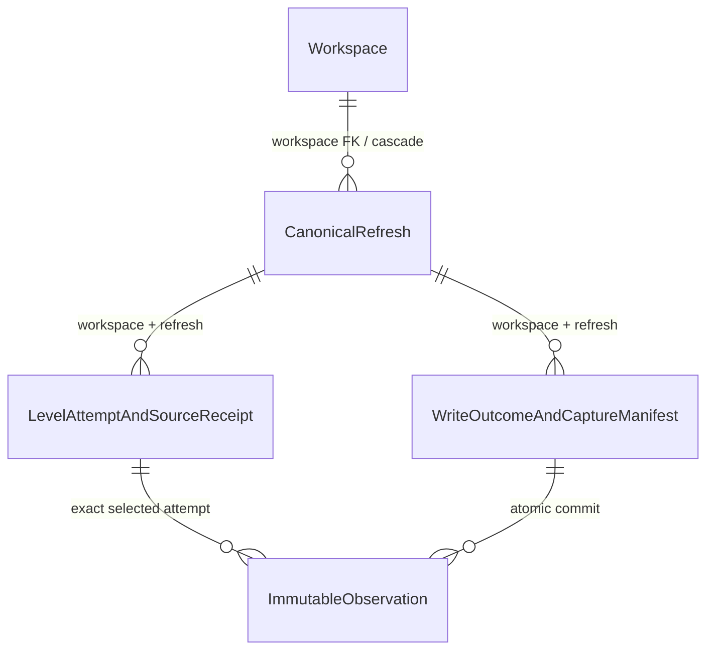

# Backend Stabilization 02B-0 — canonical provenance technical preflight

Date: 2026-10-15, Africa/Cairo. Reference master:
`b3da053becb4ac1e89bf040eb251eaaf73e4065c`.
**Discovery/design/approval package only. No implementation authorized or performed.**

**02B-0G amendment:** four-table architecture is now approved in principle and
isolated technical testing is authorized. The [technical-validation annex](BACKEND_STABILIZATION_02B0G_TECHNICAL_VALIDATION.md)
records executed PostgreSQL/Prisma evidence, supersedes the original90/30 retention
proposal with a universal event+90-day recommendation, and specifies native-DDL
ownership/Prisma corrections. Application implementation remains unauthorized.
Historical untested statements below describe the original preflight; use the
annex for current tested facts and explicit NOT_TESTED boundaries.

Status labels used throughout: **VERIFIED** = inspected repository/provider-code
fact; **PROPOSED** = technical recommendation, not implemented; **UNKNOWN** = not
established by available evidence; **REQUIRES APPROVAL** = explicit prerequisite
to any migration, wiring, activation or deployment. The five approved principles
and Constitution R-8 remain unchanged. Gates B/C remain **BLOCKED**.

## 1. Fresh baseline and tensions resolved before the schema proposal

**VERIFIED:** fresh origin/master matches the reference; no open PRs at discovery.
PR #576 merged at this master, with the same tree as reviewed head
`4fbf1ff450da07ea1f1dd239ed17ba1d2b6e735e`; its F-1/F-2 remediation is present on
trunk by content. Read [02A](BACKEND_STABILIZATION_02A_CANONICAL_PROVENANCE.md),
[01](BACKEND_STABILIZATION_01_META_COMPLETENESS.md), schema/migrations, connector,
normalizer/sinks, workspace lifecycle and verdict/worker paths. CLAUDE.md,
Product Truth Rulings, governance README and REVIEW_GATE retain authority.

Master Tests38702376402 / Architecture38702376440 have four failed job records,
zero steps. The inspected backend annotation identifies payment/spending
restrictions. Hosted verification is NOT_TESTED. No CI exception transfers here.
The existing frontend checkpoint still says Phase 9 implementation NOT STARTED;
02A records its historical discrepancy with later onboarding work. No new baseline
drift prevents this preflight; this task does not reconcile or advance that roadmap.

**VERIFIED design tensions, disclosed before proposing storage:**

1. A source receipt seals before normalization/commit can finish. It cannot contain
   a mutable future write outcome. Keep source and write outcomes independently sealed.
2. The sink commits entities separately from metrics. An entity or exhausted cursor
   is not a committed observation/cohort receipt. Couple only the canonical metric
   batch, observations and successful commit manifest in the same transaction.
3. Refresh source selection closes provider-attempt admission, not ingestion.
   A sealed refresh may have a later failed/unknown write receipt.
4. Exhausted Insights supplies no authoritative applicable-member proof. Capture
   can be useful while every campaign membership proof remains UNKNOWN. Do not
   add an evaluation-ready COMPLETE state or another Meta request to remedy that.
5. A stable MetricSnapshot UUID is mutable. Exact observation content must survive
   a restatement independently of that locator.

These are implementation hazards, not changes to approved policy. The design below
resolves their representation; executable SQL, capacity and concurrency remain unproved.

## 2. Confirmed existing database and runtime contracts

| VERIFIED contract | Source and consequence |
|---|---|
| Non-daily partial unique key: entityId, entityLevel, date, granularity, source, measurementWindow; predicate excludes DAILY | [nonDailySnapshotWrite.js](../src/services/connectors/nonDailySnapshotWrite.js#L55), [migration](../prisma/migrations/20260824000000_b4e5_non_daily_partial_identity/migration.sql). Preserve it. Window bounds, account and refresh IDs are not in this key. |
| Upsert replaces defined values while retaining snapshot UUID; undefined is omitted, explicit null is real | [writer](../src/services/connectors/nonDailySnapshotWrite.js#L105), [existing integration case](../src/services/connectors/nonDailySnapshotWrite.integration.test.js#L145). Inspected, not rerun. The helper returns an execute count, not immutable row content. |
| Existing date/window columns are timestamp without time zone; raw writer casts instants through UTC | [timestamp conversion](../src/services/connectors/nonDailySnapshotWrite.js#L90), [schema](../prisma/schema.prisma#L1261). Preserve sync-date meaning and exact stored key. New event timestamps can use timestamptz; source DATE labels remain dates, not invented instants. |
| Entities and metric batch are separate transactions, with orphan/zero-shadow filtering | [landSnapshots](../src/services/connectors/snapshotSink.js#L341). Existing entity success does not imply metric success; roster-only never fabricates a zero snapshot. |
| Workspace protection currently uses FOR KEY SHARE; deletion uses parent FOR UPDATE then user/credential work | [liveness](../src/lib/workspaceLiveness.js#L29), [credential lifecycle](../src/services/connectors/credentialStore.js#L272), [admin deletion](../src/routes/admin/workspaces.js#L326), [self deletion](../src/routes/user.js#L283). Key-share admits concurrent writers; it is not writer serialization or authorization. |
| Canonical fetch is three independent level traversals; all failures throw; partial level failure returns remaining rows | [fetchCanonicalAllLevels](../src/services/metaAdsService.js#L1159), [MetaConnector](../src/services/connectors/MetaConnector.js#L183). Instrument before aggregation; preserve per-level IDs and failure receipts before the aggregate throw. |
| Canonical metadata is discarded and canonical failure is best-effort | [sync](../src/services/connectors/ConnectorSyncService.js#L117). A capture failure may affect canonical availability when enabled, even though operational sync remains independent; activation needs explicit approval. |
| Worker concurrency:1 is local to one worker; manual/global sync and other instances exist | [worker](../src/workers/syncWorker.js#L108), [connection routes](../src/routes/lumi/connections.js). Do not treat a process setting as DB exclusion. Queue receipts expire, so are correlation only. |
| Identity reader takes 200, relative ranking has no completeness guard, persistence dedups by verdict enum | [identity reader](../src/services/entity-graph/EntityGraphService.js#L176), [evaluation](../src/services/verdict-engine/connectorVerdictService.js#L306), [persistence](../src/services/verdict-engine/VerdictService.js#L138). None changes in capture-only 02B. |

**UNKNOWN:** production DB version, sizes, physical bloat, write rate, p95 latency,
replication/WAL headroom, app-role privileges and deployment migration timing. No
production secrets, database connection, provider request or live sync was used.

## 3. Smallest recommended capture schema — PROPOSED

### 3.1 Four tables, with two safe combinations and explicit deferrals

1. `canonical_refreshes` — immutable logical request scope and one source-selection seal.
2. `canonical_level_attempts` — admitted per-level attempt plus its one terminal
   source receipt. Combining admission/receipt is safe only with a once-only seal.
3. `canonical_write_attempts` — separate admitted DB write/outcome plus the campaign
   capture manifest on successful commit. These share one atomic commit, so a
   separate population-manifest table is unnecessary for capture-only.
4. `canonical_observations` — immutable exact committed materialization projections.

Defer evaluation-reference tables, Decision FKs/changes, authoritative membership-
proof storage, cohort indexes, reader APIs and ranking consumption. Source receipt
cannot combine with write outcome: they have different failure/commit boundaries.
Observations cannot be replaced by a hash or a mutable MetricSnapshot reference.

Refresh selection also references its three chosen level-attempt IDs. These are
nullable during admission and use deferred composite FKs to handle the intentional
parent/child cycle. A MetricSnapshot ID is a locator only, not a lineage FK.
Future evaluation references are deliberately absent from this capture diagram.

### 3.2 Common conventions and ownership

All four tables have these columns, included in each specification below:

| Column | PostgreSQL type | Nullable | Default / rule |
|---|---|---|---|
| workspace_id | uuid | no | none; server-resolved scope, never client-selected |
| id | uuid | no | none; server-generated before admission, reused only for identical artifact replay |
| created_at | timestamptz(3) | no | clock_timestamp(); DB admission time, never evidence measurement time |
| record_version | smallint | no | 1; CHECK =1 for this capture format |

`NULL` below always defaults to SQL NULL; no measured count defaults to zero.
NN means NOT NULL. All IDs/receipts are internal; no new public enum or API field
is proposed for activation. Type/constraint names are a design, not a migration.

Every child FK includes workspace_id and refresh_id. Each reference targets an
explicit non-partial PK below, not the existing partial snapshot index. Root FK:
workspace_id → workspaces.id ON DELETE CASCADE. Child ownership follows that root;
do not duplicate independent workspace FKs with inconsistent lifetimes.

At refresh admission, verify the selected credential's existing workspace/platform/
account binding inside the workspace-protected DB transaction and capture a
secret-free attestation/hash of that binding. Never infer workspace ownership
from a provider account string, a hash or liveness alone. A later account switch
does not rewrite captured scope. Reject cross-workspace references at the FK layer.
Propose an INSERT guard on the root: after the live-parent lock, read the matching
active marcom_credentials workspace/platform/account row FOR SHARE, without token
columns, and require the captured account to agree. This blocks concurrent account
switch during admission. Missing unmanaged vault table or unavailable binding
refuses capture admission, not a forged ownership claim. It attests the app's
configured credential binding, not independent provider/business ownership.
No FK to the raw credential token row is proposed: token rotation/deletion must not
destroy legitimate historical evidence. Nor add a new unique index to populated
Account/MetricSnapshot merely to make the ledger convenient.

For each observation, the capture writer must verify entity → account → workspace
and platform/account external ID through the existing graph, under the transaction
in §4. The polymorphic entity column cannot get one ordinary FK to three tables;
a constraint trigger validates that graph mapping by entity_level. Store ambiguity
as an explicit source-binding fact, never pretend an unverified row was verified.
For a genuinely foreign entity, abort the canonical commit. A derived ACCOUNT row
is linked to the selected campaign attempt, marked DERIVED_ACCOUNT_ROLLUP with its
contributor identities; it is never campaign membership evidence.

### 3.3 canonical_refreshes

Additional columns (all columns not listed as NULL are NN with no default):

| Column(s) | Type | Nullable / default / checks |
|---|---|---|
| platform | text | NN, default 'META', CHECK ='META'; other provider capture is deferred |
| provider_account_id | text | NN; normalized nonempty account ID, bounded 128 characters |
| measurement_window | text | NN, default 'CUMULATIVE_30D', CHECK same |
| requested_start, requested_end | date | NN; end >= start; retain exact canonical DATE labels |
| scope_descriptor | jsonb | NN; immutable allowlisted request/account-set descriptor, versioned |
| scope_hash, account_set_hash | bytea | NN; each exactly 32 bytes; rules §3.7 |
| retry_of_refresh_id | uuid | NULL; same-workspace predecessor, no self/cycle |
| correlation_id | text | NULL; bounded 128-character server correlation, no secret/raw request content |
| selected_campaign_id, selected_adset_id, selected_ad_id | uuid | NULL until selection seal; exact source attempt IDs including failed selections |
| not_started_levels | jsonb | NN, default []; distinct valid level strings only |
| attempt_dispositions | jsonb | NULL until selection seal; frozen list of every admitted attempt ID/level, selected flag and receipt hash or explicit unknown-at-seal fact |
| selection_hash | bytea | NULL until seal, then 32 bytes |
| source_sealed_at | timestamptz(3) | NULL until seal; does not imply write success |
| retain_until | timestamptz(3) | NN; T0 DB time+90-day minimum; atomically extend to each later admission/seal event+90 days per02B-0G; never evidence freshness |

PK `(workspace_id,id)`. Retry FK `(workspace_id,retry_of_refresh_id)` to this PK,
ON DELETE NO ACTION, DEFERRABLE INITIALLY DEFERRED. Selection FKs for each chosen ID:
`(workspace_id,id,selected_X_id)` → level_attempts `(workspace_id,refresh_id,id)`,
same deferred NO ACTION behavior. A seal trigger validates expected level, terminal
receipt, matching scope and that every required level is selected or explicitly
not-started, with no overlap. Never call an admitted/unsealed level not-started:
if no terminal attempt can be selected for it, leave the logical refresh open/
UNKNOWN in this minimal format. Nonselected attempts/dispositions at seal are
frozen in attempt_dispositions; a later source receipt cannot rewrite that earlier
unknown-at-seal fact. Admission is blocked once source_sealed_at is set.

Scope/admission fields are immutable from insertion. Only the entire selection
group NULL→sealed is permitted once. A separate retention privilege may only
extend retain_until; it cannot change scope/selection. Same-workspace retry lineage
must be acyclic and bounded; reject reused identity with different descriptor.
The retry predecessor must already exist at INSERT and retry links cannot later
change; no forward references or self-links that could create a refresh cycle.

Required indexes: PK; `(workspace_id,created_at)`; `(retain_until,workspace_id,id)`;
referencing retry index `(workspace_id,retry_of_refresh_id)`. No additional three
selection indexes: their lookup already fixes the root PK (workspace_id,id), so
testing the selected ID filters at most that one row. No dedup UNIQUE by window or
scope_hash: concurrent/repeated genuine refreshes must remain distinct.
Frequency: one root per actual logical account/window refresh; one selection update.

### 3.4 canonical_level_attempts

| Additional column(s) | Type | Nullable / default / checks |
|---|---|---|
| refresh_id | uuid | NN |
| level | text | NN; CHECK IN ('campaign','adset','ad') |
| ordinal | integer | NN; positive; allocated under locked open refresh |
| retry_of_attempt_id | uuid | NULL; predecessor under same refresh and level |
| request_descriptor | jsonb | NN; exact allowlisted level fields/params, preserving omitted settings |
| request_hash | bytea | NN, 32 bytes; binds root scope and level descriptor |
| call_intent_at | timestamptz(3) | NN; application timestamp immediately before admitted invocation, not proof provider accepted it |
| source_receipt | jsonb | NULL until terminal source facts are known |
| receipt_hash | bytea | NULL, then 32 bytes |
| source_sealed_at | timestamptz(3) | NULL, then set atomically with receipt/hash |

PK `(workspace_id,refresh_id,id)`; refresh FK to root ON DELETE CASCADE.
UNIQUE `(workspace_id,id)` prevents one attempt UUID being reused under a different
refresh in that workspace; UNIQUE `(workspace_id,refresh_id,level,ordinal)` orders
admissions. Retry FK of the three matching
parent columns to the same PK, deferred NO ACTION; trigger also checks same level,
predecessor ordinal and acyclicity. No unique scope/window or retry-only overwrite.
Required extra index `(workspace_id,refresh_id,retry_of_attempt_id)`; PK/ordinal
indexes already support refresh-child enumeration. Receipt/hash/timestamp must
all be NULL or all present. BEFORE UPDATE permits only that one terminal group fill;
BEFORE DELETE rejects ordinary application deletion. Unknown/crashed attempts stay
unsealed; no success marker from a timer or absence of error.

Receipt v1 requires: level/requestHash, outcome EXHAUSTED/CAPPED/FAILED/UNPROVEN, actual
finishedAt, pagesObserved/rowsObserved/distinctIdsObserved (nullable when unknown),
hasNextAtStop/truncated (nullable), safe returned entity ID list when captured,
field/date-presence summary and allowlisted errorCode or null. Counts are observed
values only. Failure does not require a complete partial-row list or fabricate [].
EXHAUSTED requires positive end-of-traversal evidence, CAPPED positive cap evidence;
a returned array without that proof is terminal UNPROVEN, not a successful
exhaustion inferred from missing hasNext. This sealed uncertainty is immutable.
Neither EXHAUSTED nor an empty returned list means cohort COMPLETE. Private receipt
outcome strings are not connector-health/product states.

Frequency: normally three admitted attempts and three source seals per refresh;
each actual restarted level invocation adds another row. Pagination remains within
one attempt. No retry behavior or new request is introduced by this proposal.

### 3.5 canonical_write_attempts — outcome plus capture manifest

| Additional column(s) | Type | Nullable / default / checks |
|---|---|---|
| refresh_id | uuid | NN; root must have a frozen source selection |
| ordinal | integer | NN, positive, allocated under refresh lock |
| retry_of_write_id | uuid | NULL; same-refresh predecessor, immutable failure remains |
| source_selection_hash | bytea | NN, 32 bytes; binds the frozen source selection |
| planned_payload_hash | bytea | NULL until normalization succeeds; then 32 bytes for retained normalized input, never an invented empty plan |
| planned_at | timestamptz(3) | NULL until plan seal, set once with planned_payload_hash |
| outcome | text | NULL until terminal; CHECK IN ('COMMITTED','FAILED') when nonnull |
| error_code | text | NULL or fixed sanitized code ≤64 characters; never provider/raw SQL exception text |
| commit_manifest | jsonb | NULL unless COMMITTED; schema v1 described below |
| outcome_hash | bytea | NULL, then 32 bytes for exact final outcome/manifest |
| sealed_at | timestamptz(3) | NULL, set once for terminal outcome |
| committed_at | timestamptz(3) | NULL unless COMMITTED; same transaction's receipt timestamp |

PK `(workspace_id,refresh_id,id)`; root FK CASCADE. UNIQUE `(workspace_id,id)`
prevents a write identity being reused under another refresh. UNIQUE
`(workspace_id,refresh_id,ordinal)`; same-parent retry FK to this PK, deferred
NO ACTION, plus referencing retry index. An admitted open row contains no fake
success/zero counts. On COMMITTED, error_code is NULL and manifest/hash/timestamps
are present. On FAILED, error_code/hash/sealed_at are present, manifest and
committed_at are NULL. Crashes/uncertain COMMIT acknowledgements remain open until
DB truth is read, never changed to failure merely because the client timed out.
committed_at is the receipt time recorded within that transaction, not PostgreSQL's
exact WAL commit timestamp.
Admit this row before normalization/entity landing, so their known failures can
seal a distinct FAILED outcome too. Normalization failure leaves plan fields NULL;
successful normalization fills hash/planned_at once before entity/metric work.
COMMITTED requires that sealed plan. A plan seal is not a write-success seal and
cannot be changed after finalization. No failed/unknown terminal receipt is upgraded.

Manifest v1 stores selected level-attempt IDs/hashes, returned campaign IDs from
that source receipt, actual observation IDs/content hashes, per-level committed
counts, and every normalization/orphan/zero-shadow/duplicate disposition with
identity and reason. Actual rows, not planned rows, determine counts. Reserve
`membershipProofRef:null`, `membershipEvidence:null`, `membershipCoverage:'UNKNOWN'`
as mandatory v1 JSON values. Schema checks forbid nonnull proof references or a
different coverage value in capture v1. This is an explicit technical restriction,
not an API status. Unknown population must not be promoted because the manifest
was successfully sealed. Positive membership storage/authority requires a future
approved format/migration, not a hidden flag change.

A deferred constraint trigger validates that COMMITTED manifests exactly match
the transaction's observations, selected source bindings and exclusion accounting;
FAILED/open rows have no committed observation children. This cross-row rule is
not a CHECK expression. Ordinal allocation/sealing use refresh then write-row locks;
all selected attempt IDs are taken from immutable root selection, not arbitrary
JSON supplied by a caller. BEFORE UPDATE allows only the once-only plan group and
once-only terminal outcome group; sealed groups cannot be changed. Normal
application DELETE is denied. Frequency: normally one write row and one commit
seal per refresh with landed canonical data; DB-only retry gets another row. A
zero-row successful canonical response may still commit an empty capture manifest
without manufacturing MetricSnapshots; membership remains UNKNOWN.

### 3.6 canonical_observations

| Additional column(s) | Type | Nullable / default / checks |
|---|---|---|
| refresh_id, write_id, source_attempt_id | uuid | NN; exact root/write/selected per-level source binding |
| entity_id | uuid | NN; existing internal entity ID |
| entity_level | text | NN; ACCOUNT/CAMPAIGN/ADSET/AD only |
| external_entity_id | text | NULL when genuinely unestablished; bounded 128; source-binding uncertainty explicit |
| date | timestamp(3) without time zone | NN; exact existing stored snapshot sync date, interpreted under the existing UTC contract |
| granularity, source, measurement_window | text | NN, no defaults; CHECK DAILY/META/CUMULATIVE_30D respectively; DAILY here is the existing granularity label, not a DAILY measurement population |
| window_start, window_end | timestamp(3) without time zone | NULL exactly when the stored value is null; never filled by ledger |
| materialized_snapshot_id | uuid | NULL locator, no FK; a later restatement/deletion cannot rewrite observation identity |
| committed_projection | jsonb | NN; exact selected MetricSnapshot values after SQL casts/defaults, plus versioned copied entity/partition attributes where actually known |
| source_facts | jsonb | NN; safe raw-date presence/values, metric-field presence/validity, account/source/currency/timezone origin, direct versus derived origin and binding ambiguity |
| content_hash | bytea | NN, 32 bytes; §3.7 |

PK `(workspace_id,id)`. Write FK `(workspace_id,refresh_id,write_id)` → write PK,
source FK `(workspace_id,refresh_id,source_attempt_id)` → level-attempt PK, both
ON DELETE CASCADE. Trigger checks selected attempt and expected source level;
ACCOUNT rollup is the explicit campaign-derived exception. UNIQUE
`(workspace_id,refresh_id,write_id,entity_id,entity_level,date,granularity,source,measurement_window)`.
Required source-reference index `(workspace_id,refresh_id,source_attempt_id)`;
the UNIQUE prefix covers write-child lookup/cascade. Defer entity-history/GIN/
cohort indexes until a real consumer is separately approved.

All columns immutable after INSERT; UPDATE and normal DELETE denied. A committed
projection's identity/window fields must equal the typed observation columns;
validate that consistency before inserting and in the commit constraint trigger.
The selected source receipt may remain UNPROVEN; storing facts does not qualify
them for assessment. A committed
materialization key yields one final observation for that write, not every
intermediate upsert. Duplicate input rows/colliding keys retain explicit source
dispositions and ambiguity; do not invent an exact raw-row match for the final
value. This does not authorize changing their existing metric resolution behavior.
Frequency: N observations per successful canonical batch, including at most one
derived account row if it actually landed; no rows on failed metric commit.

### 3.7 Seals, hashes, references and deletion

Required JSON v1 envelope details, not arbitrary raw provider blobs:

- scope_descriptor: formatVersion1, normalized workspace/platform/account,
  configured account-set identity list/revision, requested DATE bounds,
  level specs (fields and actual params, preserving omitted values), endpoint
  template, observed SDK/API version or explicit null with origin, account
  timezone/value provenance and secret-free credential-binding attestation.
  Duplicate typed root fields must agree; unavailable API version is never filled
  from an unrelated raw-fetch constant.
- request_descriptor: parent scope hash, one exact level, fields/params passed
  to that SDK traversal and configured cap; no live credential or next cursor.
- source_facts: formatVersion1, raw source-date presence/validity/validated DATE
  values (or null), metric-field presence/validity before coercion, declared
  provider/account binding and its origin, currency/timezone origin, direct versus
  derived row kind and contributor IDs, explicit duplicate/mapping ambiguity.
  Do not copy arbitrary unknown strings or infer a reported field from defaults.
- committed_projection: all persisted MetricSnapshot evidence fields needed to
  reproduce the input, including identity/date/window, spend UTC bounds, money,
  counters, nullable ratios/frequency/reach/actionMetrics/budget and currency
  provenance. Copy only allowlisted entity/partition attributes actually observed;
  absent attributes remain null/unknown. Never re-read today's graph for old facts.

JSON schema/type/length/required-key checks are part of the proposed writer and
seal validators. No defaults create missing measured fields. The source receipt
and commit manifest shapes are specified with their owning tables above.

Use Node's existing crypto capability: SHA-256 of versioned canonical UTF-8 JSON.
Rules v1: recursively lexicographic object keys; null explicit; unknown omitted
only where format permits; preserve array order for observations/actions, sort
declared sets by stable identity; finite numbers only, -0→0; no NaN/Infinity;
canonical lowercase UUIDs; event instants ISO UTC millisecond strings; source DATE
labels remain YYYY-MM-DD. Integer money/counters come from exact stored values,
not reformatted displays; don't normalize arbitrary user strings into a new fact.

Scope hash covers declared source/account-set/request contract and window; request
hash adds exact level descriptor. Receipt hash covers that request binding and
all sealed source facts. Observation content hash covers typed snapshot key,
committed projection and source_facts, not mutable current DB lookups. Outcome hash
binds refresh/selection, write identity, actual observation IDs+hashes and manifest
or failure. A hash is an integrity/dedup aid, not authority, proof of membership
or protection against a privileged writer. Replay compares full versioned content
as well as hashes. DB checks byte length, sealing and ownership; no unverified
cross-language hashing function or new extension is assumed.

Use BEFORE triggers for immutable columns/once-only transitions and deferred
constraint triggers for cross-row commit consistency and selected-level checks.
For Prisma5.22, selection inverse relations must be represented as lists;
unmodified introspection generates invalid one-to-one relations. Native DDL owns
deferral, CHECKs, triggers/functions and grants; schema-only diff misses their
drift. Require exact catalog assertions. Insert observations only under a locked
open write, defer their terminal-write check, and validate the full set once per
write seal to avoid quadratic manifest scans. See02B-0G for actual evidence.
Restrict ordinary roles to permitted insert/seal operations; retention/deletion
privileges are separate. Trusted migration owners can bypass such mechanisms;
this is not a claim of protection against DB superusers. Trigger design must be
verified in the isolated migration/concurrency suite before approval to activate.
PostgreSQL CHECK cannot enforce arbitrary cross-table invariants; composite FKs
and constraint triggers are the proposed mechanisms ([constraints](https://www.postgresql.org/docs/18/ddl-constraints.html),
[triggers](https://www.postgresql.org/docs/18/sql-createtrigger.html)).

Ordinary deletion of individual sealed records is forbidden. Authorized retention
deletes whole eligible refresh trees; workspace deletion always cascades the root.
Selection/retry NO ACTION FKs are deferred so a whole deleted dependency set can
disappear together without SET NULL rewriting evidence. Retention must preserve
referenced retry ancestors or delete the full unreferenced dependency set. Propose
a root DELETE guard permitting only the authorized retention role (eligible,
unreferenced dependency set) or workspace-driven cascade where the owning workspace
is already absent in that deleting transaction. Child DELETE guards require the
refresh parent to be absent in that transaction, permitting only parent-driven
cascade. No SET NULL facts, caller-set GUC or pg_trigger_depth authorization shortcut.
The exact cascade visibility/trigger ordering must be proven in isolated tests
before implementation approval;02B-0G now proves the specified mechanisms on PG18.4
with synthetic ownership fixtures, not the final migration/runtime. No FK to mutable snapshot
rows; their deletion does not erase evidence, while tenant deletion does.

## 4. One commit and concurrency protocol — PROPOSED; isolated evidence in02B-0G

### 4.1 Exact boundaries and lock order

Use READ COMMITTED with explicit locking. No provider/AI work inside any DB
transaction. The smallest serialization choice is a **workspace row FOR NO KEY
UPDATE for captured canonical commit**, instead of a new advisory-lock namespace
or lock table. It serializes captured commits across that workspace's accounts
and windows, including same-key restatements. It blocks workspace deletion but is
broader than account-level locking; latency cost is UNKNOWN and requires measurement.
Source metadata transactions can keep parent FOR KEY SHARE. Lock semantics and
consistent ordering follow PostgreSQL's [locking reference](https://www.postgresql.org/docs/18/explicit-locking.html).

Universal order for ledger DB work: **workspace parent → credential binding row
(admission only) → refresh row → selected
source rows (campaign/adset/ad, then ID) → write row → existing graph rows by
Account/Campaign/AdSet/Ad and ID → sorted metric logical keys → observation rows**.
Skip irrelevant later locks; never acquire the parent after a child. Acquisition
is serial/deterministic, not Promise.all over conflicting identities. Proposed
commit lock_timeout 2s, statement_timeout 10s, total transaction budget 15s are
approval/test candidates, not measured safe values or changes to today's defaults.

| Boundary | DB actions / durable result |
|---|---|
| T0 refresh admission | Parent KEY SHARE → matching credential binding row FOR SHARE (no token projection); verify captured account and INSERT guarded root with fixed scope/retention. Release before provider work. |
| T1 level admission | Parent KEY SHARE → open refresh FOR UPDATE; allocate ordinal and INSERT level attempt. Commit before actual level traversal. If source admission cannot persist, do not perform an untracked canonical read while capture is enabled. |
| Provider read | Outside transaction: existing getInsights and cursor pages only; capture facts in the same per-level boundary, no additional request or retry. |
| T2 source seal | Parent KEY SHARE → refresh → attempt; once-only terminal receipt/hash. Known failures persist before propagating all-level throw. A nonselected late attempt may seal its own facts but cannot change frozen refresh selection. Crash/failed DB acknowledgement requires querying receipt truth; absence remains UNKNOWN. |
| T3 source selection | Parent KEY SHARE → refresh FOR UPDATE; stop admission and freeze chosen terminal IDs or explicit not-started dispositions. No favorable flags copied from earlier attempts. Closure means source selection closed, not write complete. All-level failure closes failed selections and throws; no write receipt is required when no canonical batch exists. |
| T4 write admission and normalization | Parent KEY SHARE → refresh → INSERT open write row with frozen source-selection hash, plan NULL. Normalize outside DB transactions, preserving raw-date/presence facts. In a short parent→refresh→write transaction, once-seal planned_payload_hash/planned_at after successful normalization. Known normalization failure seals FAILED without inventing a plan. Failed prior writes stay failed; DB retry gets a new write ID. |
| T5 entity landing | Existing separate entity batch under live parent; deterministic model/ID order. Preserve all current entity/status/roster-only semantics. Do not claim metric success. Known entity-batch failure seals the admitted write FAILED; successful entities can still coexist with a later failed metric commit. |
| T6 atomic canonical commit | Parent NO KEY UPDATE → refresh → sources → write, then graph/key order above. Revalidate graph ownership and final orphan/zero-shadow dispositions under this view; perform canonical metric upserts; read exact stored rows while their row locks are held; INSERT immutable observations; build manifest from actual rows/dispositions; seal COMMITTED. All succeed or all roll back. Entity batch remains separate. |
| T7 known preparation/write failure | After known normalization/entity failure or T6 rollback, parent KEY SHARE → refresh → write; seal FAILED only if failure/noncommit is established. Failure to persist leaves open/UNKNOWN. Never mark failure just because a COMMIT reply was lost; first check DB outcome. |

T6 needs a canonical-only sink/transaction seam; do not globally refactor the
GA4/MANUAL/DAILY writers. Existing execute-count helper cannot prove exact committed
content: either canonical-specific RETURNING or an in-transaction read after all
upserts must capture SQL's actual final values. No post-commit lookup of an ID
can substitute for the immutable projection. Sorted writes/reads and triggers must
retain UTC conversion, partial unique index, undefined-versus-null behavior and
all existing row values. Snapshot rows filtered by current guards are recorded
as dispositions, not fabricated observations.

Provider exceptions and receipt-storage/capture exceptions must be distinct local
failure classes. A failed T2 seal after successful provider return leaves source
outcome unrecorded/UNKNOWN; the existing aggregate catch must not mislabel that
DB error as a provider FAILED receipt or issue further untracked reads. Abort the
captured canonical branch explicitly; operational sync remains separate. Prove
this classification with injected failures before approving capture wiring.

**Legacy-writer limit:** existing binaries/feature-off paths do not take this new
writer lock. PostgreSQL row/upsert locks still protect the exact row values captured
inside T6; a later legacy restatement cannot rewrite the observation. They do not
make all concurrent business guard reads race-free or make later snapshots carry
lineage. Activation requires both Web and Worker on compatible dormant wiring;
no evaluation-ready population claim may rely on an uncaptured competing writer.
The existing materialization/latest-selector behavior is not redefined here.

### 4.2 Required outcomes at difficult boundaries

| Situation | Proposed behavior / invariant |
|---|---|
| Concurrent manual/worker or identical windows | Distinct refresh and level IDs; parent NO KEY UPDATE serializes captured T6 commits, not network reads. No scope/window UNIQUE that collapses attempts. |
| Same snapshot key, changed values | Each committed T6 gets its immutable exact value projection; snapshot UUID can stay the same. Observations/receipt timestamps never restated. |
| Fetch retry | New levelAttemptId under the same still-open identical-scope parent; after selection seal, new refresh. Keep failed predecessor. No automatic new retry policy. |
| DB retry after proved rollback | New write ID, same source selection only if identical retained normalized payload still exists; validate full payload/hash. Never reconstruct it from a newer snapshot or counts. Lost payload requires any later actual provider invocation to get new attempt identity. |
| COMMIT result uncertain | Query admitted write ID. COMMITTED with matching complete content is idempotent success; proved FAILED stays failed; indeterminate/open stays UNKNOWN. Do not create duplicate observations by assuming rollback. |
| Crash before terminal source seal | Admitted source remains UNKNOWN, no invented FAILED/EXHAUSTED result. No receipt recovery from logs/health. |
| All provider levels fail | Three immutable failed source receipts and closed logical selections survive aggregate throw where DB available; otherwise unrecorded terminal facts UNKNOWN. No complete empty batch. |
| Workspace deletion during active fetch | No network-held DB lock. Whichever parent lock wins determines commit versus cascade. Deleted parent forbids all later receipt/observation resurrection; existing NoWorkspace/WorkspaceUnavailable distinctions remain. |
| Entity partial landing or orphan/zero-shadow filtering | Persist exact source/disposition evidence; entity success alone does not create observations. A source-complete read can have no committed metrics. Membership stays UNKNOWN. |
| Ledger/metric failure in T6 | Roll back both canonical metrics and new observations/manifest. Prior canonical evidence remains unchanged. Operational path and old receipts are separate. |
| New account selection during old fetch | Retain original scope; do not relabel source account. Future scope compatibility is UNKNOWN until separately qualified. |

No race/concurrency outcome above has been tested in 02B-0. These are acceptance
requirements for an explicitly approved implementation, including ordinary
non-key workspace updates and deletion-lock interaction.

## 5. Capture feasibility — source facts, instrumentation and unknowns

| Fact | Current evidence | Capture-only treatment |
|---|---|---|
| Requested account/level/fields/time_range | VERIFIED in auth arguments and canonicalInsightsParams; [level specs](../src/services/metaAdsService.js#L1126) | Capture existing arguments/version/hash; declared account scope is not independent proof of business ownership. |
| Per-level exhaustion/cap and collected rows | VERIFIED in [collectCursorPages](../src/services/metaAdsService.js#L213) and fetchCanonicalInsights; aggregate only retains OR/truncated | Instrument per-level result before concat/catch. Capture observed traversal facts, not inferred membership. |
| Page count / failure progress | Helper knows page iterations on success; count is logged/discarded. On exception current caller cannot recover partial helper progress | Additional in-process capture seam needed; unknown when not observed. Page iterations are not an exact HTTP/retry count. |
| Raw date_start/date_stop and metric field presence | Existing requested/returned row fields, before normalization | Capture safe presence/validity/values before fallback/coercion. Missing source dates stay missing even if normalized window uses request. |
| Currency/timezone provenance | Existing auth/normalizer resolution | Copy known reported/fallback provenance; no new lookup. Do not promote fallback to provider-reported. |
| Effective canonical SDK API version | initSdk initializes the SDK without explicitly setting that version; API_VERSION/GRAPH_BASE is the separate raw-fetch path | Capture an actually observable SDK configuration/version or null. Do not label SDK Insights v21 merely from the raw Graph constant; no provider probe is authorized. |
| SDK transport retry counts, complete HTTP accounting/usage headers | UNKNOWN from this wrapper's returned cursor data | Do not invent counts. New request-accounting/SDK instrumentation is a separately bounded task, not proof from page count. |
| Historical provider snapshot consistency while pages mutate | Not guaranteed by current code/responses | UNKNOWN; exhausted traversal is not provider-wide transactional snapshot. |
| Applicable campaign membership M and historical exclusions | No proven authoritative temporal/scope artifact in existing canonical responses | membershipProofRef/Evidence stay null; UNKNOWN is enforced in v1 manifest. Current operational roster, empty Insights and take:200 cannot establish M. |
| Existing roster row metadata | Already fetched operationally, with 575 cap/failure metadata | May capture existing facts, never infer canonical membership authority from endpoint name or operational health. No new roster request authorized. |
| Missing/deleted/archived members or complete external business-account set | Unavailable proof in current responses | UNKNOWN; obtaining additional provider evidence or adding new requests requires separate approval. |
| Successful materialization and exclusions | Sink knows filtering; writer currently returns count | In-transaction capture instrumentation required; exact SQL final rows plus typed identity/provenance, not later ID lookup. |

Source observations are not automatically complete individual measurements:
num()/rounding/defaults can yield a normalized zero from missing/invalid fields.
Capture those raw-presence/validity facts without changing metric values. Future
acceptable-provenance and eligibility predicates remain unimplemented. No additional
provider request, polling, Direct Meta AI Analysis change or provider integration.

## 6. Storage, retention and security assessment

### 6.1 Illustrative model — not production measurement or price

The original model used no database measurement;02B-0G adds labelled isolated
measurements without treating them as production budgets. Repository facts: three canonical
levels, MAX_PAGES=50; explicit adset page size200 and ad size500; campaign canonical
request has no explicit limit, so its actual page size/cap cannot be promised.
35,000 observations below is a sensitivity case, not a proven combined cap.

Let N be committed observations per refresh (including a derived account only if
landed), R refreshes/day and D retained days. Model includes heap/JSON/TOAST and the
listed indexes with B=2/4/8 KiB per observation, plus 128 bytes/N for repeated
source/manifest identity/disposition references and 24 KiB per refresh for small
root/attempt/write metadata. These are explicit assumptions, not measured tuple or
compression sizes. Approximate live bytes = R × D × [24KiB + N×(B+128B)]. Additional
attempts, errors, large scope/field summaries, retained retry ancestors, WAL,
replicas, backups, bloat and indexes exceeding B are not covered by that formula.

| N | MiB/refresh at B=2/4/8KiB | GiB for 90d ×4/day, B=2/4/8KiB | GiB for 90d ×24/day, B=4KiB |
|---|---|---|---|
| 100 | 0.23 / 0.43 / 0.82 | 0.08 / 0.15 / 0.29 | 0.90 |
| 1,000 | 2.10 / 4.05 / 7.96 | 0.74 / 1.42 / 2.80 | 8.55 |
| 6,200 | 12.89 / 25.00 / 49.22 | 4.53 / 8.79 / 17.30 | 52.73 |
| 35,000 | 72.66 / 141.01 / 277.73 | 25.54 / 49.58 / 97.64 | 297.45 |

Values calculated with PowerShell arithmetic, MiB=2^20 and GiB=2^30. Multiply by
captured accounts/workspaces; read R from measured scheduled/manual activity before
activation, not from an assumed cron-only rate. A 2× bloat/headroom sensitivity
doubles these figures; replica/backup/WAL factors need separate measurement.
No cloud price, production row count or benchmark is claimed.

**REQUIRES APPROVAL:** candidate payload ceilings16KiB/observation and8MiB/manifest,
and an account/workspace storage budget. Oversize must cause an explicit capture/
canonical commit failure or capture-off decision, never silently omit members and
claim completeness. Measure p50/p95 payloads and pg_total_relation_size (including
indexes/TOAST) on isolated fixtures first; PostgreSQL's [size functions](https://www.postgresql.org/docs/18/functions-admin.html)
describe what those measurements include. No GIN indexes or partitioning before
measurements demonstrate need; partition/FK complexity is deferred.

### 6.2 Retention proposal and immutable references

**PROPOSED/REQUIRES APPROVAL, corrected by02B-0G:** use a universal90-day floor at
T0 admission, including failed/unknown graphs, and atomically extend the root to
at least DB event time+90 days on every later admission/selection/source/plan/write
seal. DB-stamp event times; narrow privileged triggers extend the deadline without
granting app retention authority. This replaces the outcome-dependent90/30 rule;
failed-only graphs cost up to3x their former time-based population before additional
events/dependencies. Compare the atomic30→90 alternative and tested boundaries in
the annex. A deadline is eligibility for
reviewed deletion, not proof that deleting is safe. Retry-linked ancestors retain
their descendants' necessary lifetime. Keep all level/failure/disposition records
needed to interpret a retained successful graph; do not prune just the failure.

First schema/dormant-wiring slices add no automated pruning. Before capture
activation approve capacity and a verified retention operation; never enable an
unbounded production writer without budget/stop criteria. Later Decision/learning
references must add same-workspace restrictive FKs or an approved durable pin
mechanism before they can be issued. Existing Decision.evidenceReference JSON is
not such a pin. Referenced graphs remain while those consumers require them; no
automatic expiry silently destroys an auditable Decision. Their final retention
duration, legal deletion obligations and archival/export mechanism remain approval
items. Tenant deletion overrides retention and cascades all tenant-owned ledger
data. Schema has no automatic link to Decisions and changes no existing history.

### 6.3 Minimize payload and authorization surface

Keep exact necessary normalized metrics, identity/window/currency fields, typed
source presence/validity and bounded partition attributes. Never store access or
refresh tokens, credential ciphertext, OAuth state, SDK request objects, next URLs/
cursors, Authorization headers, arbitrary provider error text, customer-level
conversion payloads or creative/PII dumps. Names and raw unrecognized action strings
are not needed for immutable metric replay. Redact errors to fixed classes and
correlation IDs; unknown error details stay in access-controlled redacted operational
logs, not ledger JSON. Unsafe/unbounded source values are flagged as uncaptured,
never laundered into a known source fact.

Tenant isolation needs composite FKs, explicit workspace predicates, graph/account
binding checks and existing caller/role authorization. No claim of new RLS or
database-role isolation until actual role privileges are verified in an approved
environment. Database owners remain privileged. No new read/export API, public
identifier, hosted billing configuration or production inspection in this task.
Any privileged validator/purge function needs a fixed safe search_path, least-
privilege owner and revoked PUBLIC execute grant; caller-set flags are not
authorization. Verify grants as part of the future migration, not by assumption.

## 7. Incremental implementation and deployment safety — REQUIRES APPROVAL

Recommend a **separate additive schema-only first PR**, then dormant wiring, then
controlled activation. Do not combine migration and writer activation under
Render's current auto-deploy behavior.

| Proposed bounded slice | Scope and gate |
|---|---|
| 02B-1 additive storage only | Four new tables, exact constraints/functions/triggers and reviewed Prisma representation, no capture writer/feature activation. Explicit transactional migration where supported; no backfill, snapshot index change, Account index or Decision reference. Prove migration and cascade on isolated migrated PostgreSQL; independent review and separate migration/deploy approval. |
| 02B-2 dormant capture wiring | Canonical-only source instrumentation and atomic sink seam, default-off setting in code. Old feature-off path remains; both Web/Worker must understand the schema/flag. Mocked provider + isolated transaction/concurrency RED/GREEN. No new provider call, eligibility, ranking/API/Decision changes. |
| 02B-3 approved capture activation | Storage/latency/retention budgets and monitoring ready; separately approved two-service plan. Start narrowly in an isolated/test scope, then explicitly authorized production scope. No readiness certification or membership COMPLETE. |
| Later, separate approvals | Positive membership authority, full reader coverage/shadow evaluation, public contracts, ranking consumption and Decision basis/dedup effects. They do not ship under capture approval. |

Migration should create empty tables/indexes and named triggers/functions, then
only brief workspace-FK-related locks; no scan/backfill of MetricSnapshot. Existing
workspace FK validation/DDL locks can still block live operations. Set reviewed
lock/statement budgets; do not promise zero downtime. Do not assume the deploy
runner automatically wraps every SQL file: the migration must explicitly specify
its transaction/failed-application recovery and be tested through the actual
Prisma migrate deploy path. Use migration history and catalog assertions for
retries; IF NOT EXISTS alone can conceal a wrong preexisting definition. Do not
use concurrent index creation inside a transaction. No migration is written here.

**Two-service sequence:** (1) approve exact artifacts, rollback image/commit and
auto-deploy handling; (2) apply/verify additive schema through one controlled
migration owner, never a race between two build commands; (3) deploy compatible
default-off Web and Worker binaries; confirm both versions/flags; (4) validate
isolated behavior/metrics; (5) only then approve capture activation for both.
Old binaries can ignore new tables; new binaries feature-off must tolerate absent
tables. Feature-on must fail canonical capture explicitly when schema contract is
missing/incompatible, not silently issue untracked writes. Production DB engine
compatibility and actual Render build/migration drift remain UNKNOWN until the
separate authorized deployment review; editing docs/blueprint is not live truth.

**Rollback:** disable capture in both services, wait for/identify in-flight captured
commits, then roll binaries back if needed. Keep additive tables and immutable
evidence, no DROP/down migration or relabelling. A partly observed failure stays
FAILED/UNKNOWN. Old readers still have their known completeness hazard; rollback
does not certify correctness. Documentation-only merge itself can trigger Web/
Worker deployments from master, so even this PR requires deliberate deployment-
impact review; no merge or deployment is authorized by this instruction.

**Observability candidates, not measured gates:** per-scope admitted/open/sealed/
failed source and write counts, oldest open receipt age, disposition counts,
membership UNKNOWN count, graph mismatches, commit/lock latency, deadlocks/timeouts,
T6 rollback rate, payload bytes, rows/refresh, relation/index/TOAST growth and WAL
headroom. Separate source from storage success. Do not infer healthy from zero
warnings or missing telemetry. Approve numeric stop thresholds after isolated
measurements; example timeout/payload values above are proposals, not benchmarks.

## 8. Exact future RED/GREEN requirements — no passes claimed

Every provider test uses complete mocks and the configured networkGuard. Integration
tests use a fresh isolated PostgreSQL with all migrations; barrier-controlled
connections prove interleavings, not sleep timing. Use test:full for DB claims.

1. Migration from clean and current migrated baseline; catalog-check all PK/FKs,
   partial snapshot index unchanged, trigger/privilege installation, failed DDL
   rollback and actual migration retry. No existing row/UUID/date relabelling.
2. Cross-workspace refresh/retry/selection/write/observation references rejected;
   wrong level/account/entity graph rejected; tenant read predicates tested.
3. Every immutable field/terminal receipt update and ordinary delete rejected;
   identical replay succeeds, changed content under same identity rejects. All
   success/failure/open shape constraints and mandatory UNKNOWN manifest fields.
4. Three level IDs, two retries of one level, stopped admission after seal,
   nonselected late result, all-level failure persisted before aggregate throw,
   crash before source seal remains UNKNOWN. No SDK request count fabricated.
5. Failure after each T6 step: none of new canonical metrics, observations or
   COMMITTED manifest survive; T5 entities may remain. T7 failure recorded only
   after proved rollback. Lost COMMIT acknowledgement resolves via durable ID.
6. Same-key metric restatement preserves UUID and existing null/undefined/UTC
   behavior, while two captured commits retain separate immutable exact projections.
   Test differing requested windows with colliding current key and date.
7. Concurrent manual/worker, identical scope/windows and independent accounts:
   barriers show parent lock exclusion, sorted key order and no manifest splicing;
   inject deadlock/serialization/timeout without changing failed receipts to success.
8. Workspace deletion before/during T0/T2/T6/T7 and ordinary non-key workspace
   updates; verify lock order, whole cascade including retry/selection cycles,
   no receipt resurrection and no child-delete trigger blocking authorized cascade.
9. Roster-only, orphan, zero-shadow and duplicate-key cases: preserved original
   metric behavior, exact committed/disposition mapping, no fabricated zero snapshot
   or authoritative raw-row binding. Derived account row marked as derived.
10. Exhausted/empty/capped Insights and200-identity reader cases never yield cohort
    COMPLETE in v1; raw missing dates stay missing despite normalizer fallback;
    per-level failure does not poison another level's source facts.
11. Feature-off with absent/present schema and mixed old/new binaries; feature-on
    missing schema refuses canonical capture; rollback leaves ledger intact. No
    new network calls, operational/daily behavior, API shapes or Decision changes.
12. Deterministic source/content hashes across JSON key order, sets, null/omitted,
    -0, Unicode, numeric/date roundtrips; inconsistent hash/content rejected by
    capture writer. Measure serialization/storage/index/TOAST/latency with bounded
    illustrative fixtures at N100/1000/6200/35000 and oversize limits; report actual
    results before setting production budgets. Verify retention reference protection.

## 9. Exact Product Owner technical decisions requested

**02B-0G approves the four-table architecture in principle and isolated testing.
No migration/runtime/deployment implementation is approved.** Remaining choices
below require decisions after independent review of the annex.

1. Four-table capture scope and combinations/deferrals; review each column/PK/FK,
   source-only seal and write/manifest coupling before authorizing migration.
2. Default-off failure policy: with capture on, fail the canonical best-effort
   branch rather than commit uncaptured canonical metrics when ledger unavailable;
   operational sync remains separate. Approve this data-availability impact.
3. Workspace-level NO KEY UPDATE serialization, deterministic lock order and
   candidate timeouts versus measured latency; no hidden advisory/global lock.
4. Immutable projection/source-fact allowlist, hash format, duplicate/derived-row
   binding and candidate payload/storage budgets. No raw secrets/PII retention.
5. Recommended universal event+90-day minimum, retry dependency retention, future restrictive
   references/pins and verified pruning policy before activation; no indefinite
   writer enabled on assumed capacity.
6. Capture v1 mandatory UNKNOWN membership with no membership authority/evaluation
   references; any future proof acquisition/new provider request is separate.
7. Additive migration-only PR first, isolated verification requirements, migration
   owner and two-service dormant rollout/activation/rollback plan. Documentation
   PR merge also needs deployment-impact review. No CI exception requested/granted.
8. Approve a separately bounded 02B-1 brief only after independent review; this
   document is not permission to write Prisma/migration/runtime code.

## 10. Verification record and independent review checklist

**Original02B-0 work:** Git/GitHub/source inspection; PostgreSQL18 primary documentation
check; illustrative PowerShell storage arithmetic; documentation scope/link/diff
checks. No SQL/migration executed, isolated DB started, runtime test suite run,
production secret inspected, Meta request sent or deployment configuration changed.
The02B-0G annex now records actual isolated SQL/Prisma tests and remaining untested
requirements. No SQL was committed to the application and no runtime was changed.
Hosted PR-head CI status is recorded separately in the PR; no exception authorized.

Independent reviewer: verify fresh baseline and unchanged approved principles/R-8;
check minimal combinations versus independent failure boundaries; trace every
column/default/composite FK/selection cycle/delete path; challenge source and
ownership claims; confirm exact T6 atomicity and legacy-writer limitations; audit
UNKNOWN membership,200-reader cap and date fallback; recalculate storage sensitivities;
review retention/pin/deletion and privileged-role assumptions; assess migration and
two-service rollback; ensure tests/benchmarks are requirements, not claimed results.
Request Product Owner approval of §9 before any implementation. **Stop at Draft PR;
no migration, runtime work, merge, deployment or Gate B/C advancement.**
